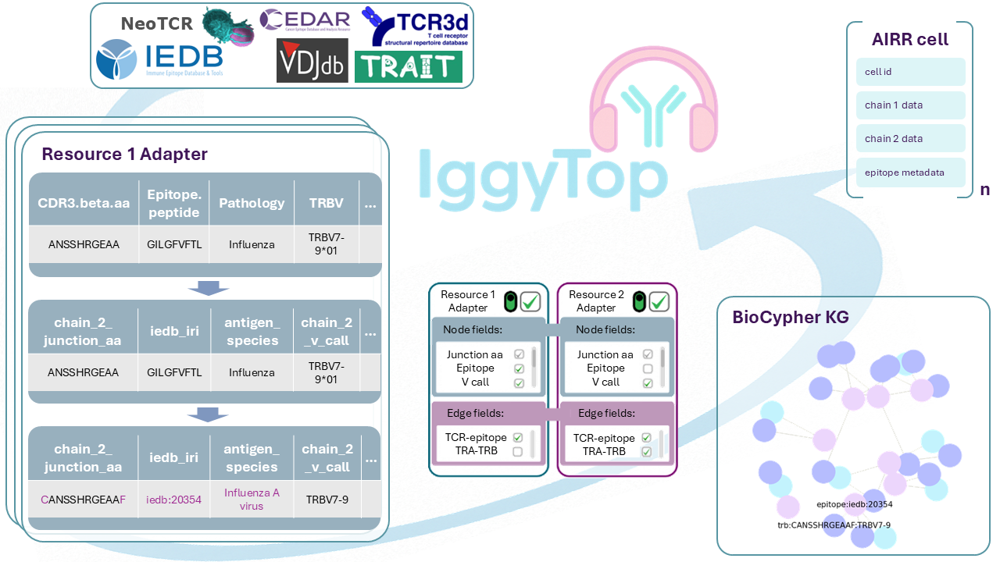
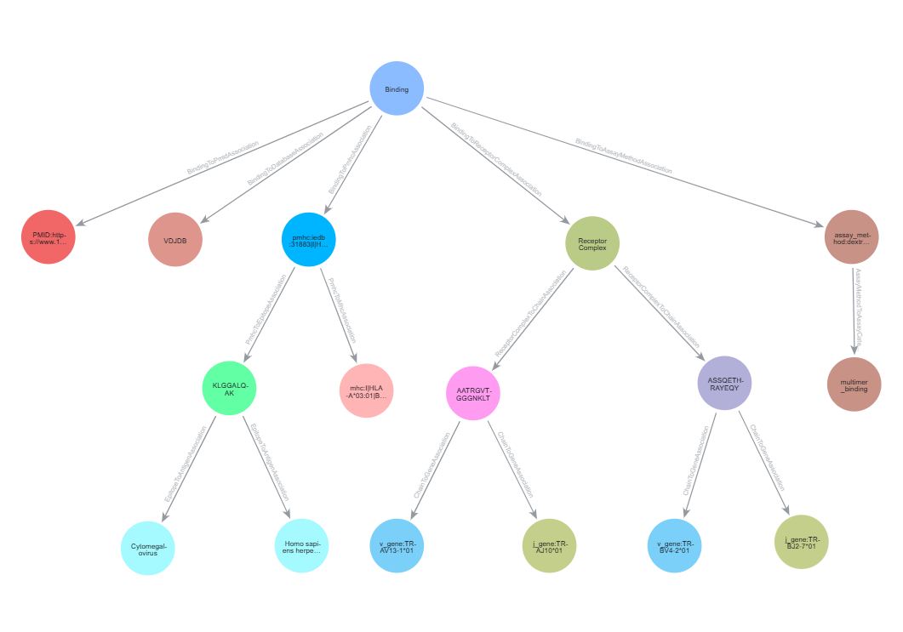

# IggyTop: **I**mmunolo**g**ical **G**raph **Y**ielding **Top** receptor-epitope pairings

[](https://www.python.org/downloads/)
[](LICENSE)
[](https://img.shields.io/readthedocs/iggytop)
[](https://zenodo.org/records/20037575)


This repository uses the [BioCypher](https://biocypher.org) framework to harmonize databases with existing immunoreceptor-epitope matching information. The aggregated data is provided in tabular and graph formats.

BioCypher provides a modular architecture where each data source is processed through dedicated transformation scripts called adapters. These adapters are the interface between raw data sources and the IggyTop dataset. We use [tidytcells](https://tidytcells.readthedocs.io/en/stable/index.html) to standardize gene names, cdr3 sequences and junction sequences for both BCR and TCR datasets. We aim to follow [AIRR](https://docs.airr-community.org/en/stable/) and [IMGT](https://www.imgt.org/) standards. This project provides adapters for the following databases:

- [IEDB](https://www.iedb.org/)
- [VDJdb](https://github.com/antigenomics/vdjdb-db)
- [McPAS-TCR](https://friedmanlab.weizmann.ac.il/McPAS-TCR/)
- [CEDAR](https://cedar.iedb.org/home_v3.php)
- [ITRAP](https://github.com/mnielLab/ITRAP_benchmark/blob/main/ITRAP.csv) (data filtered from [10X Genomics Dataset](https://www.10xgenomics.com/library/a14cde))
- [TRAIT](https://pgx.zju.edu.cn/traitdb/)
- [TCR3d](https://tcr3d.ibbr.umd.edu/)
- [NeoTCR](https://github.com/lyotvincent/NeoTCR?tab=readme-ov-file)
- [BATCAVE](https://github.com/meyer-lab-cshl/BATMAN-paper)

The aggregated data from all adapters is available in the (bimonthly) [releases](https://github.com/biocypher/iggytop/releases). These releases are used by [Scirpy](https://scirpy.scverse.org/en/v0.24.0/index.html), which provides a simple interface to access the data in [anndata](https://anndata.readthedocs.io/en/latest/) format. You can also rebuild the DB using the provided code with custom parameters. On a consumer laptop, building the full DB typically takes 20-30 minutes.


The full documentation is available online via [Read the Docs](https://iggytop.readthedocs.io/en/latest/).

## Graphs vs. Tables
Two paths are covered: A tabular path that stacks source databases into a large table (used in Scirpy and Releases), and a knowledge graph path that converts the source data into a graph. Both are documented in the [documentation](https://iggytop.readthedocs.io/en/latest/). For details, see [Graph Data Structure](https://iggytop.readthedocs.io/en/latest/graph_data_structure.html) and [Tabular Data Structure](https://iggytop.readthedocs.io/en/latest/tabular_data_structure.html).

## Quick start: Tabular data (Scirpy)

To use the database in Python, install [Scirpy](https://scirpy.scverse.org/en/v0.24.0/index.html) (>=v0.24.0). Then use [this function](https://scirpy.scverse.org/en/v0.24.0/generated/scirpy.datasets.iggytop.html) to load the dataset in [anndata](https://anndata.readthedocs.io/en/latest/) (tabular) format:

```python
import scirpy as ir

iggytop = ir.datasets.iggytop(deduplicated=True, tag='latest')

# Or (e.g. for VDJdb only)
vdjdb = scirpy.datasets.vdjdb(tag='latest')
```

## Prerequisites
- [uv](https://docs.astral.sh/uv/): dependency management, required to run DB/graph generation locally.
- [docker](https://www.docker.com/get-started/): run containers, required to run Neo4j container for inteactive graph queries.

## Knowledge graph in Neo4j (Docker image)

Every [data release](https://github.com/biocypher/iggytop/releases) ships a
ready-to-run Docker image, `ghcr.io/biocypher/iggytop-neo4j`: a Neo4j
instance with the full IggyTop knowledge graph built in. You only need
Docker. There's no need to clone the repo, install Python, or build anything.

```bash
docker run -d --name iggytop \
  -p 7474:7474 -p 7687:7687 \
  -e NEO4J_AUTH=neo4j/neo4jpassword \
  -v iggytop_data:/data \
  ghcr.io/biocypher/iggytop-neo4j:latest
```

**Image tags**: `latest` points to the latest data release. Every release is
also available under its own tag (e.g. `data-2026.08.03.063907`, see the
[package page](https://github.com/biocypher/iggytop/pkgs/container/iggytop-neo4j)),
so you can pin the exact data version you used.

### Querying the graph

- **Browser**: open http://localhost:7474 and log in with `neo4j` / `neo4jpassword`
  (change it via `NEO4J_AUTH` or in `docker-variables.env`).

In the browser, you can now run
queries against the database — the full graph has over a million nodes, so
scope exploratory queries with a `LIMIT`, e.g.:
```
MATCH (n) RETURN n LIMIT 100
```

To get a feel for the schema, a good starting point is to expand outward
from a single `Binding` node — the central node type linking a TCR/BCR
receptor to the epitope it binds — and follow its relationships a few hops
out:
```
MATCH path = (n:Binding)-[*1..4]->(m) WHERE n.complete = true RETURN path LIMIT 16
```
For more information on the Graph schema, check out [Graph Data Structure](https://iggytop.readthedocs.io/en/latest/graph_data_structure.html).
The result should look similar to this:



You can adapt color, size and labels of the nodes in the control panel on the right.

## Local Installation

1. Clone the repository:
   ```bash
   git clone https://github.com/biocypher/iggytop.git
   cd iggytop
   ```

2. Install dependencies using uv:
   ```bash
   # Core installation (includes dev dependencies)
   uv sync

   # Include documentation and Jupyter tools
   uv sync --group docs
   ```

3. You are ready to go!
   ```bash
   uv run create_knowledge_graph.py
   ```
   or

   ```bash
   uv run create_release.py
   ```
More information can be found in the [documentation](https://iggytop.readthedocs.io/en/latest/).


## Pipeline

- `create_release.py`: builds every selected adapter's source table exactly once, then emits the raw merged dataset, the filtered+deduplicated dataset (in [anndata](https://anndata.readthedocs.io/en/stable/index.html)/ AIRR JSON format, for integration into [Scirpy](https://scirpy.scverse.org/en/latest/)), and the neo4j knowledge graph files from that same run, avoiding rebuilding the tables multiple times. Each output can be toggled independently:
```bash
uv run create_release.py --adapters VDJDB CEDAR --filter-10x
```
`--filter-10x` only affects the deduplicated dataset. Use `--not_merged`, `--not_deduplicate` or `--not_graph` to skip any of the three outputs, and `--graph-output-format` to choose the graph's BioCypher output format (default `neo4j`).

- `create_knowledge_graph.py`: a standalone, graph-only entrypoint into `io.create_knowledge_graph()`, useful when you don't need the AnnData/AIRR outputs. Use the `--adapters` flag to select specific source databases and `--output-format` to choose the output (`neo4j`, `networkx` or `airr`; default `neo4j`):
```bash
uv run create_knowledge_graph.py --adapters VDJDB CEDAR --output-format networkx
```

- `src/iggytop/adapters` contains modules that define each data source adapter.

- `src/iggytop/config/schema_config.yaml`: defines the schema of the knowledge graph. It is used by BioCypher to map the data source to the knowledge representation based on ontology (see [this part of the BioCypher tutorial](https://biocypher.org/tutorial-ontology.html)).

- `src/iggytop/config/biocypher_config.yaml`: defines BioCypher parameters such as the mode, separators, and other options. More on its use can be found in the [documentation](https://biocypher.org/BioCypher/reference/biocypher-config/).

## Releases, Testing and CI/CD

IggyTop uses GitHub Actions to automate **bimonthly data releases** and ensure data integrity through continuous integration.
Each release is built by `create_release.py` and covers both the tabular datasets and the knowledge graph.
Check out the latest release [here](https://github.com/biocypher/iggytop/releases/latest).
### Bimonthly Data Releases
Find the releases [here](https://github.com/biocypher/iggytop/releases)
- **Frequency**: Automated releases on the **1st day of every 2nd month** (first scheduled on **May 1, 2026**).
- **Release Assets**: the merged and deduplicated datasets (AnnData / AIRR JSON) and `knowledge_graph.tar.gz` (neo4j-admin import files).
   Check out the release notes for more information on the released datasets.
- **Docker image**: every release also publishes [`ghcr.io/biocypher/iggytop-neo4j`](https://github.com/biocypher/iggytop/pkgs/container/iggytop-neo4j), a Neo4j image with that release's knowledge graph built in, tagged with the release tag (`latest` follows the latest release). See [Knowledge graph in Neo4j (Docker image)](#knowledge-graph-in-neo4j-docker-image).

### Automated Testing
Before any data is released, the CI pipeline (based on GitHub Actions) runs a validation suite to catch breaking changes in upstream databases.

**How to run tests locally:**
```bash
# Install all dependencies (including docs for notebook testing)
uv sync --all-groups

# Install Jupyter kernel for notebook execution (one-time setup)
uv run python -m ipykernel install --user --name python3

# Run all tests (including notebook validation)
uv run pytest tests/
```
**Why the kernel installation?** The test suite includes validation of Jupyter notebooks (tutorials and database summaries) to ensure they execute without errors. This requires a Jupyter kernel registered with the name "python3" to match the notebooks' configuration. The installation is a one-time setup per environment.

**How to test the CI pipelines**
Ensure you have Docker and `act` installed, then run:
```bash
# Run the workflow
act workflow_dispatch -W .github/workflows/ci_ingestion.yml
```

## Related work
If you find a dataset (e.g. training data for a model) and would like to find the source of the records using the IggyTop dataset, check out [this tool](https://github.com/RaphaelDeGottardi/TCR_source_detection).

This project is built on (and part of) the [BioCypher](https://github.com/biocypher/biocypher) framework. Make sure to check out this cool project!


## Contributing

Contributions are welcome! Please feel free to submit a Pull Request or create
an Issue if you discover any problems.

## License

This project is licensed under the MIT License - see the LICENSE file for
details.

## Citation

If you use IggyTop in your research, please cite it using the following DOI:

[](https://zenodo.org/records/20037575)

You can find the full citation details on the [Zenodo page](https://zenodo.org/records/20037575).

We also provide a CITATION.cff file for customized citations.
